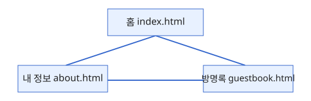
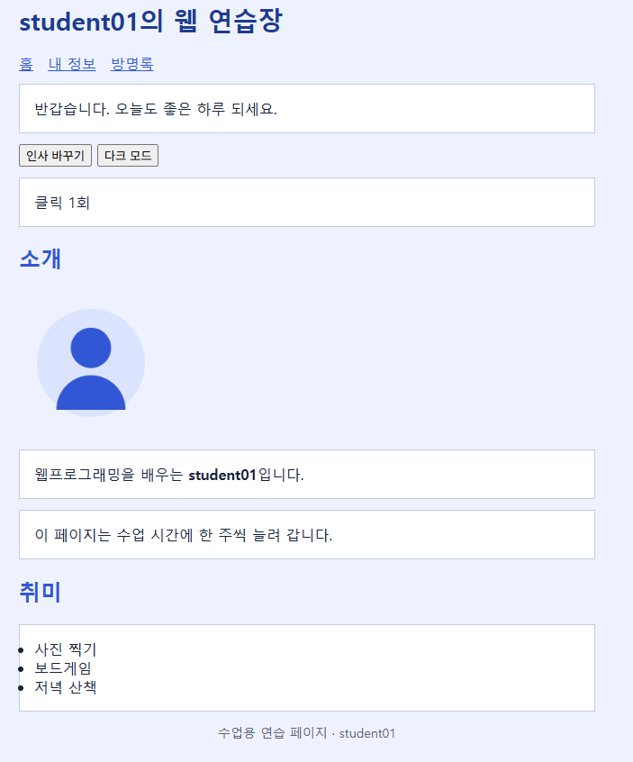
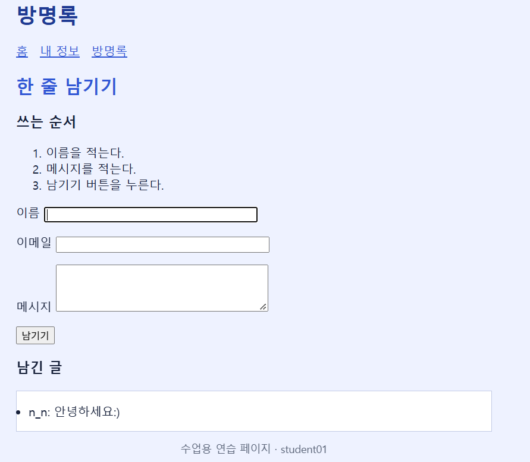

<<<<<<< HEAD
# student01의 웹 연습장

웹프로그래밍 수업에서 한 주씩 늘려 가는 **자기소개 사이트**입니다.

## 공개 주소

- [https://github.com/nana-0904/day10.git/](https://github.com/nana-0904/day10.git/)

## 페이지

| 페이지 | 파일 | 내용 |
|---|---|---|
| 홈 | [index.html](index.html) | 인사말, 소개, 취미 목록 |
| 내 정보 | [about.html](about.html) | 아이디·이메일·관심 분야 표 |
| 방명록 | [guestbook.html](guestbook.html) | 이름·메시지 폼 |



## 기능

- 홈의 "인사 바꾸기"와 "다크 모드" 버튼을 누르면 문장과 배경색이 바뀌고 클릭 횟수가 1씩 오릅니다.
- 방명록에서 이름과 메시지를 적고 "남기기"를 누를 때마다 아래 목록에 한 줄씩 쌓입니다. 빈칸이면 안내 문장이 나옵니다.

다크 모드 버튼은 `body` 에 class 하나를 붙였다 뗍니다.

```js
darkButton.addEventListener('click', function () {
  document.body.classList.toggle('dark');
  countUp();
});
```

## 화면





## 이번에 배운 것

- GitHub에 과제를 올리고 commit하는 법
- 12~13주차에 발표할 과제하는 법 
- README를 작성하는 방법